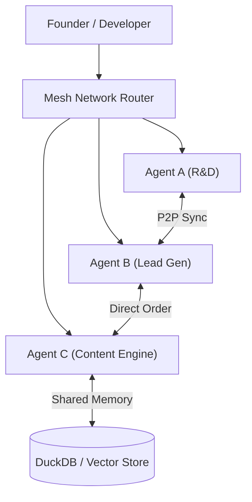

# ⚡ Agent-Mesh

> **Decentralized, Peer-to-Peer Multi-Agent Swarm Framework with Persistent Memory & Dynamic Routing.**

[](https://github.com/kushaggarwal2007-byte/agent-mesh/stargazers)
[](https://opensource.org/licenses/MIT)
[](https://python.org)
[](https://www.linkedin.com/in/kush-aggarwal-52a624450)
[](https://instagram.com/kushsup)

---

## 💡 Why Agent-Mesh?

Traditional agent frameworks rely on a **centralized coordinator** that turns into a single point of failure and bottleneck as agent swarms scale past 5+ units.

**Agent-Mesh** eliminates the coordinator bottleneck by treating agents as **autonomous peer nodes** that can:
- 🔁 **Peer-to-Peer Task Dispatching**: Agents delegate directly to other specialized agents.
- 🧠 **Persistent Episodic & Semantic Memory**: Shared context without re-ingesting prompts.
- ⚡ **Zero-Bloat Async Execution**: Built entirely on top of pure asynchronous Python coroutines.
- 🛡️ **Self-Healing Execution Loops**: Automatic task failover and retries.

---

## 🚀 Quickstart

```bash
git clone https://github.com/kushaggarwal2007-byte/agent-mesh.git
cd agent-mesh
pip install -r requirements.txt
```

### Basic Example

```python
import asyncio
from agent_mesh import AgentNode, MeshNetwork

async def main():
    mesh = MeshNetwork()

    # Define specialist nodes
    researcher = AgentNode(name="ResearchAgent", role="Deep Intelligence Gathering")
    engineer = AgentNode(name="EngineerAgent", role="Autonomous Code Generation")

    mesh.register(researcher)
    mesh.register(engineer)

    # Direct P2P delegation
    task = "Analyze GitHub Trending and draft architecture"
    result = await researcher.delegate(engineer, task=task)
    print("Execution complete:", result)

if __name__ == "__main__":
    asyncio.run(main())
```

---

## 🏛️ Architecture



---

## 👤 Author & Ecosystem

Built with passion by **Kush Aggarwal** — AI Systems Architect & Founder.

- 💼 **LinkedIn:** [Kush Aggarwal](https://www.linkedin.com/in/kush-aggarwal-52a624450)
- 🐙 **GitHub:** [@kushaggarwal2007-byte](https://github.com/kushaggarwal2007-byte)
- 📸 **Instagram:** [@kushsup](https://instagram.com/kushsup)

⭐ **Star this repository** if you believe decentralized swarms are the future of AI automation!
